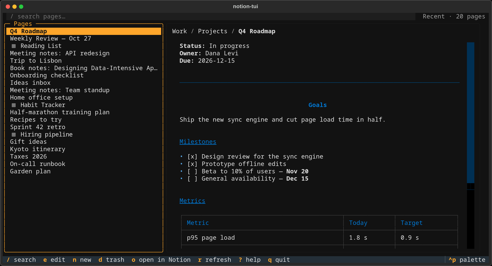
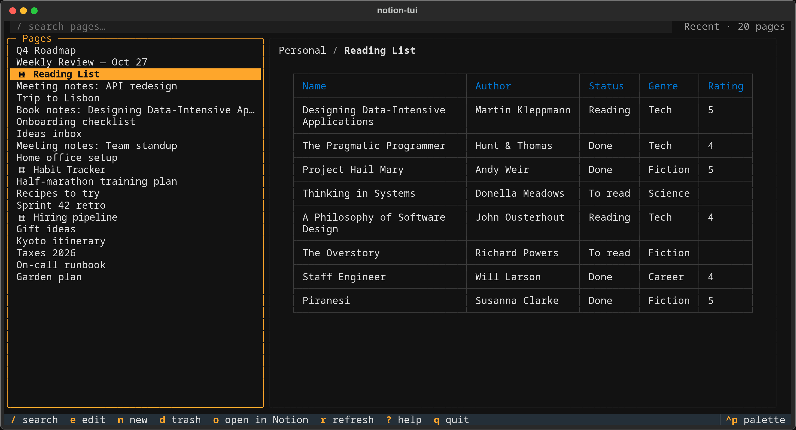
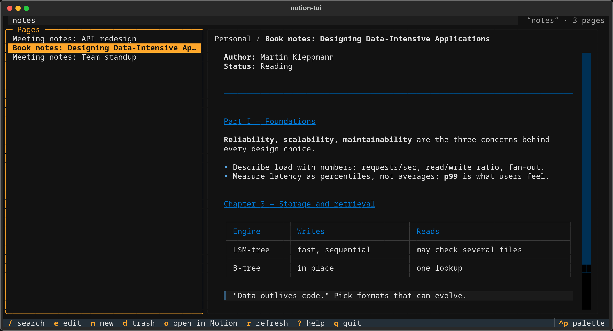

# notion-tui

Terminal UI for Notion, built on the [`ntn`](https://developers.notion.com) CLI.
Layout: page list on the left, Markdown preview on the right. The preview's top line
shows the page's path, e.g. `Notes / Quick Notes`.
Databases are listed too (marked `▦`); their preview is a table of rows, shown through the
database's saved views, with a filter line and a sort picker (see [Databases](#databases)).
Edit and trash work on pages only.



| Database preview | Search |
|---|---|
|  |  |

## Run

```
uv run notion-tui
```

Needs `ntn` on `PATH` and logged in (or `NOTION_API_TOKEN` set for `ntn pages`).

## Platforms

| Platform | Status                                                         |
|----------|----------------------------------------------------------------|
| Linux    | Supported and tested (GNOME on Wayland)                        |
| macOS    | Should work, untested. `o` opens the page but can't focus it   |
| Windows  | Not supported                                                  |

Focusing the browser window on `o` needs GNOME with the "Window Calls" extension
(see [How it works](#how-it-works)). Elsewhere the page opens in the background.

## Shortcut Keys

| Key            | Action                                   |
|----------------|------------------------------------------|
| `j` / `k`      | move in list (scroll in preview)         |
| `g` / `G`      | top / bottom (bottom loads more)         |
| `enter`        | open page full screen                    |
| `esc`          | back to list / clear search              |
| `tab`          | cycle search → list → preview            |
| `/`            | search (instant from cache, then Notion) |
| `e`            | edit page in `$EDITOR` (`ntn pages edit`)|
| `n`            | new page: title and place, then `$EDITOR` |
| `d`            | trash page (asks first)                  |
| `o`            | open page in Notion web app, focus tab   |
| `r`            | refresh                                  |
| `[` / `]`      | database: previous / next view           |
| `f`            | database: filter line (enter / esc)      |
| `s`            | database: sort picker                    |
| `F`            | database: clear filter and sort          |
| `m`            | database: load 100 more rows             |
| `,`            | options                                  |
| `?`            | help panel                               |
| `q`            | quit                                     |

## Databases

The database keys act on the database highlighted in the list; focus stays there.

- Above the table: the view tabs (current one highlighted), then a line with the filter,
  the sort and the row count (`100+` = more rows to load with `m`).
- A view shows its rows with the view's filter (and quick filters), sorts and visible
  columns. Board, calendar, gallery, timeline and map views are shown as a table, with
  the type next to the name. Form, chart and dashboard views are skipped.
- Nothing is written back to Notion: views, filter and sort changes stay in this app.
- The current view, filter line and sort are remembered per database.

### Filter line (`f`)

Space-separated terms, all of which must match. `-` in front negates a term.

| Term              | Meaning                                                    |
|-------------------|------------------------------------------------------------|
| `word`            | title contains word                                        |
| `prop:a,b`        | select / status / multi-select / person / checkbox is a or b |
| `prop~text`       | text contains (title, text, URL, email, phone)             |
| `prop=v`          | equals (text, number, date)                                |
| `prop<v` `prop>=v`| number or date compare (`<` `>` `<=` `>=`)                 |
| `-prop:a`         | not a                                                      |
| `prop:empty`      | property has no value (`-prop:empty`: has a value)         |

- Property names ignore case and may be cut to any unambiguous part: `pri:1`, or
  `created>=2026` for "Date Created" (start, then start of a word, then anywhere in it).
- Dates are `YYYY`, `YYYY-MM` or `YYYY-MM-DD`; `due=2024-03` is the whole month,
  `due<=2024` is up to the end of 2024. Back-to-back dates join (`due:2024-01,2024-02`);
  separate ones (`due:2024,2026`) must be the only term on a view with no filter, since
  Notion nests and/or only two levels deep.
- `empty` works on every property type except formula, rollup and unique ID; on a
  checkbox it means unchecked. To match the word itself, quote it: `notes:"empty"`.
- Names or values with spaces go in double quotes: `"due date">=2024 area:"side project"`.
- People are matched by name, from the people seen in the database's rows this session.
- The filter is added to the view's own filter (AND). A mistake shows a message under the
  line and nothing is sent.

### Sort picker (`s`)

Starts from the view's sorts. `a` add a level, `x` remove, `space` flip ↑/↓,
`J` / `K` move a level down / up, `c` clear, `enter` apply, `esc` cancel. The chosen
sort replaces the view's sort until `F`.

## Options

Saved in `~/.config/notion-tui/options.json` (changed with `,`).

| Option                   | Values                                   |
|--------------------------|------------------------------------------|
| Show database entries    | `yes`, `never`, `show-non-empty` (default)|

Database entries are pages that are rows of a database. `show-non-empty` lists only
entries whose page has content (a block that isn't an empty line); the status line counts
the hidden ones.

## How it works

- Every Notion call goes through `ntn`: `ntn api v1/search` for lists and search (pages and
  databases), `ntn api v1/data_sources/<id>/query` for database rows,
  `ntn api v1/views?data_source_id=<id>` and `v1/views/<id>` for a database's views,
  `ntn api v1/data_sources/<id>` for its properties,
  `ntn api v1/pages` to create a titled page under its chosen parent (page, database),
  `ntn pages get/edit/trash` for page actions.
- Calls run in the background; the screen never waits on Notion.
- Right-to-left text (Hebrew, Arabic): the terminal (kitty, VTE) puts RTL characters in
  order; the preview right-aligns paragraphs whose first letter is RTL, as Notion does.
  Single line breaks are kept, since Notion writes one block per line.
- SQLite cache at `~/.cache/notion-tui/cache.db` (`pages`, `page_content`, and for databases `views`,
  `data_source_schema`, `db_state`) makes startup
  instant and previews appear before Notion answers. A cached preview is reused while the
  page's `last_edited` is unchanged. The row below the cursor is prefetched.
- A database's views and properties are cached in the `views` and `data_source_schema`
  tables and shown at once; they are fetched again the first time the database is opened in
  a session and on `r`, and the rows are reloaded if they changed. `db_state` keeps each
  database's current view, filter line and sort. Rows are always fetched fresh, 100 at a
  time; `m` asks Notion for the next 100 with the query's cursor.
- The rows query is the view's filter AND the filter line, and the sort picker's sort, else
  the view's. Properties are referred to by ID, so renamed properties keep working.
- Whether an entry has content is checked once per edit with
  `ntn api v1/blocks/<id>/children` (2 at a time, to stay under Notion's rate limit) and kept
  in `pages.has_body`. A new `last_edited` clears it, so the next list load checks again.
- The path comes from each page's parent. Parents are cached in the `nodes` table; missing ones
  are fetched once with `ntn api v1/pages|databases|data_sources|blocks/<id>`.
- `o` raises the browser window through the GNOME Shell "Window Calls" extension
  (D-Bus `org.gnome.Shell.Extensions.Windows`), since GNOME on Wayland blocks focus
  requests from background apps. Without the extension the page opens unfocused.
